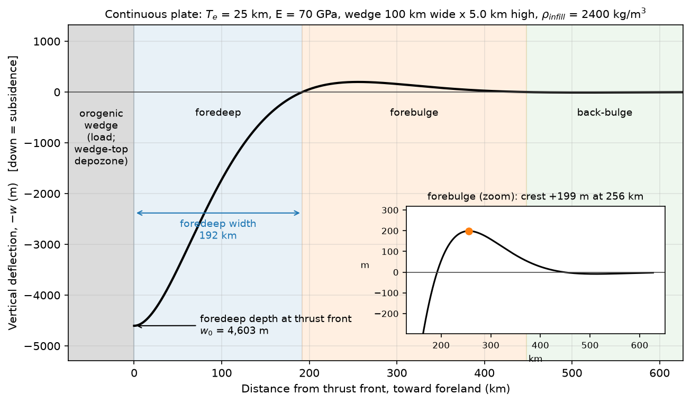

# Flexure of Earth's Continents

[](https://mybinder.org/v2/gh/Andrew-MSU/flexure-of-earths-continents/HEAD?labpath=Flexure_of_Earths_Continents.ipynb)
[](https://colab.research.google.com/github/Andrew-MSU/flexure-of-earths-continents/blob/main/Flexure_of_Earths_Continents.ipynb)

An interactive Jupyter notebook that explores how mountain belts bend the lithosphere and create foreland basins. You'll use sliders to build a simple elastic-plate model of a fold-thrust belt and its foreland basin, then compare the results with real examples like the Himalaya and the North American Cordillera.

Created by **Andrew K. Laskowski**, Department of Earth Sciences, **Montana State University**, for upper-division and graduate tectonics courses (e.g., GEO 433/533).



## What you'll learn

1. **Flexural rigidity, $D$:** how Young's modulus, Poisson's ratio, and especially the elastic thickness $T_e$ control a plate's stiffness.
2. **The flexural parameter $\alpha$ and wavelength $\lambda = 2\pi\alpha$:** how far a load's influence reaches, and why the density of the basin fill matters.
3. **Continuous vs. broken plates:** two classic solutions for a plate bent by a line load (Turcotte & Schubert, 2014), and how they change basin depth and forebulge position.
4. **Foreland basin geometry:** the wedge-top, foredeep, forebulge, and back-bulge depozones (DeCelles & Giles, 1996), and how they relate to fold-thrust belt loads.

## Prerequisites

- Introductory physical geology and some structural geology or tectonics.
- Comfort with algebra, exponentials, and trig. You won't need to solve the differential equation yourself, but you'll use its solution.
- No Python experience is required to use the sliders. Basic Python helps for the "modify the code" parts of the exercises.

## How to run it

**Interactive widgets need a live Python kernel.** On GitHub, or when you open the HTML file, you'll see static figures only. To move the sliders, use one of these options:

- **Binder (no install):** click the Binder badge above. It can take a minute or two to start.
- **Google Colab:** click the Colab badge above. You need to be signed in to a Google account.
- **On your own computer:**
  ```bash
  git clone https://github.com/Andrew-MSU/flexure-of-earths-continents.git
  cd flexure-of-earths-continents
  pip install -r requirements.txt
  jupyter notebook Flexure_of_Earths_Continents.ipynb
  ```

Whichever option you choose, **run the Setup cell first.** It is collapsed near the top, and it defines all the functions the rest of the notebook uses. Then work through the sections in order. `Flexure_of_Earths_Continents.html` is a read-only copy you can open in any browser.

## Using the sliders and "predict first" prompts

Each section has a 🔮 **Predict** prompt. For example: *if you double the elastic thickness, what happens to the rigidity?* **Write your prediction down before you touch the sliders.** Then move one slider at a time and check. The mismatches between what you expected and what you see are where most of the learning happens.

- Sliders use geologist-friendly units: km, GPa, and kg/m³.
- In the flexure plot, the shaded bands label the foreland basin depozones. The inset magnifies the forebulge, which is small compared with the foredeep.
- If you'd rather have numbers than a plot, call `flexure_summary(...)`, e.g. `flexure_summary(Te_km=30, plate='broken')`.

## The exercises

At the end of the notebook you'll:

1. Estimate flexural rigidities for oceanic lithosphere, cratons, and weaker continental platforms, and identify what controls the differences.
2. Explain what sets the flexural wavelength, and which conditions favor short vs. long wavelengths.
3. Model the Himalayan foreland: choose reasonable parameters for India, compare the modeled forebulge position with the observed one, and estimate foredeep depth next to the Main Frontal Thrust.
4. Test the hypothesis that stiffer plates make wider, shallower basins, and explore the effects of basin fill and plate model.
5. Explore how erosion (a shrinking load) changes the basin and what it might leave in the sedimentary record.

## Units and sign convention

- Inputs are in km, GPa, and kg/m³. The code converts to SI units (m, Pa) internally, so you never have to.
- Following Turcotte & Schubert (2014), deflection $w$ is **positive downward**. Plots show $-w$, so subsidence plots **down** and the forebulge plots **up**.
- Notation: $T_e$ = elastic thickness, $H$ and $W$ = height and width of the thrust wedge, $\alpha$ = flexural parameter, $\lambda = 2\pi\alpha$ = flexural wavelength.
- The model is deliberately simple: an elastic plate with the whole thrust wedge lumped into a line load at the thrust front. Real basins are more complicated, and part of the fun is figuring out where the model works and where it doesn't.

## Key references

- Turcotte, D. L., & Schubert, G. (2014). *Geodynamics* (3rd ed.). Cambridge University Press. (Ch. 3: elasticity and flexure)
- Watts, A. B. (2001). *Isostasy and Flexure of the Lithosphere*. Cambridge University Press.
- DeCelles, P. G., & Giles, K. A. (1996). Foreland basin systems. *Basin Research*, 8(2), 105–123. https://doi.org/10.1046/j.1365-2117.1996.01491.x
- Lyon-Caen, H., & Molnar, P. (1985). Gravity anomalies, flexure of the Indian plate, and the structure, support and evolution of the Himalaya and Ganga Basin. *Tectonics*, 4(6), 513–538. https://doi.org/10.1029/TC004i006p00513
- Kapp, P., & DeCelles, P. G. (2019). Mesozoic–Cenozoic geological evolution of the Himalayan-Tibetan orogen and working tectonic hypotheses. *American Journal of Science*, 319(3), 159–254. https://doi.org/10.2475/03.2019.01

See the notebook's **Sources** section for the full list.

## Repository contents

| File | What it is |
|------|------------|
| `Flexure_of_Earths_Continents.ipynb` | The interactive notebook, saved with outputs |
| `Flexure_of_Earths_Continents.html` | Static, read-only render of the notebook |
| `figures/` | Example figures from the notebook |
| `requirements.txt` | Python packages needed to run it |

Questions or corrections? Please contact Andrew K. Laskowski, Montana State University.
